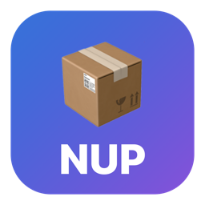
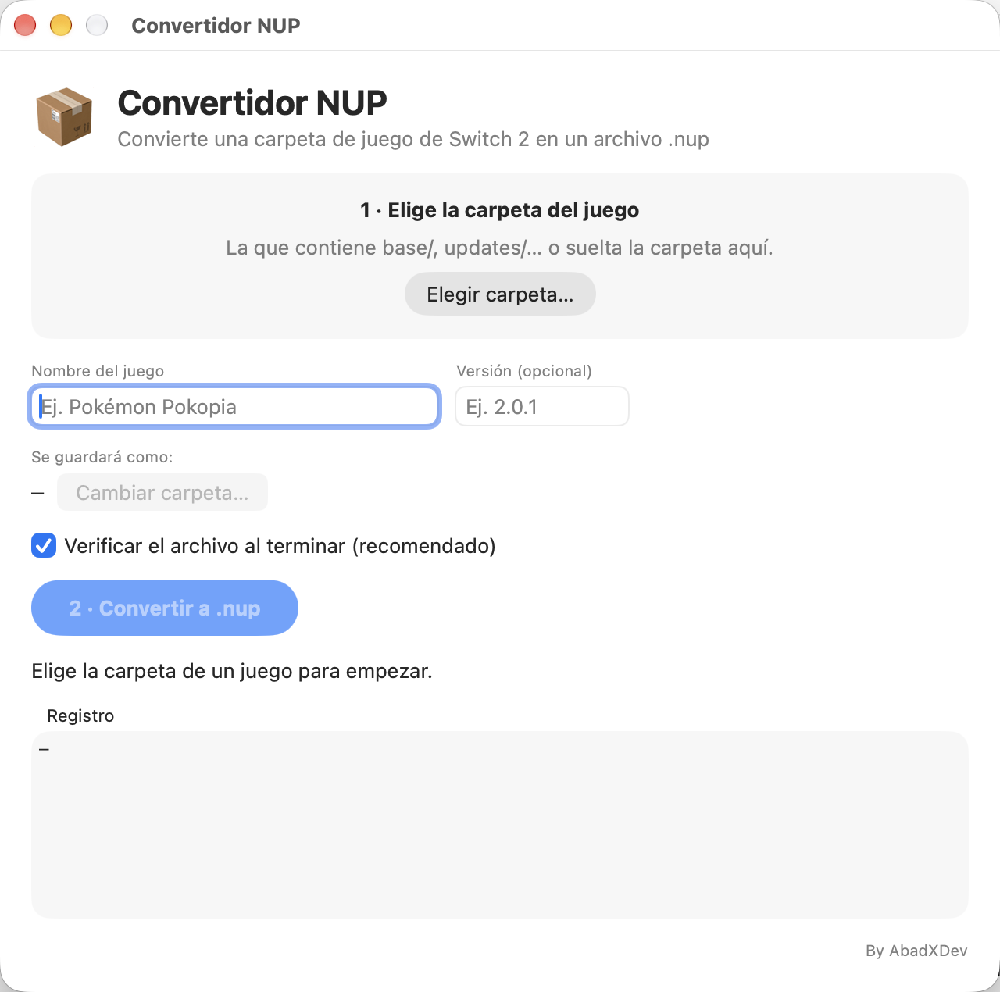

  🌐 <a href="README.md">English</a> · <strong>Español</strong> · <a href="README.zh.md">中文</a>

  

<h1 align="center">Convertidor NUP</h1>

<b>By AbadXDev</b>

  Una app súper fácil para <b>macOS</b> y <b>Windows</b> que convierte la <b>carpeta</b> de un dump de juego de Switch 2 en un solo archivo <b><code>.nup</code></b> — con muy pocos clics. Sin tocar la terminal.

  
  
  

## Descargar

| Sistema | Descarga | Notas |
| --- | --- | --- |
| **Windows** 10/11 (64 bits) | [Última versión](https://github.com/AbadXDev/convertidor-nup/releases/latest) → `Convertidor-NUP-Windows-….zip` | Descomprime y ejecuta `ConvertidorNUP.exe`. Un solo archivo autocontenido, nada que instalar. SmartScreen puede avisar de que es una app sin firmar: *Más información → Ejecutar de todas formas*. |
| **macOS** 13+ (Apple Silicon) | [Última versión](https://github.com/AbadXDev/convertidor-nup/releases/latest) → `Convertidor-NUP-Mac-….zip` | Firma ad hoc (sin notarizar): si macOS la bloquea la primera vez, haz clic derecho en la app y elige **Abrir**. |

Sin compilar nada: descarga la app desde la página de [Releases](https://github.com/AbadXDev/convertidor-nup/releases) y úsala.

## Capturas

  
  

<i>Windows · macOS — la misma app, el mismo flujo.</i>

## Qué hace

1. **Elige la carpeta** (con el botón o arrastrándola): la app comprueba que sea un dump válido (`base/`, `updates/<versión>/`, `dlc/`… o una carpeta plana con `exefs/` + `romfs/`), lee el **título ID** directamente del `main.npdm`, te dice qué paquetes trae (base, updates, DLC) y cuánto ocupa en total.
2. Rellena sola el **nombre** y la **versión** del juego desde el nombre de la carpeta (p. ej. `pokopia_v2-0-1` → «Pokopia», «2.0.1»); puedes corregirlos si quieres.
3. **Convierte**: mira la barra de progreso mientras empaqueta. Al terminar, el `.nup` queda verificado en profundidad (SHA-256) por defecto, para que sepas que el archivo está bien.

El resultado se llama `Nombre [TítuloID].nup` y se guarda junto a la carpeta de origen (puedes elegir otro destino).

## Requisitos

- Windows 10/11 (64 bits) o macOS 13 o superior (Apple Silicon).
- En el primer uso, si la herramienta de empaquetado no está instalada, la app la instala con **1 clic**: descarga la herramienta de código abierto [`nup`](https://github.com/a55uka/nup) de a55uka y la deja configurada sola. Necesita internet y **Python 3.10 o superior** — y si falta Python, la propia app lo detecta y te guía paso a paso para instalarlo.

## Compilar desde el código

- **macOS** (SwiftUI): `./build.sh` — compila la app, genera el icono, la firma ad hoc e instala **Convertidor NUP.app** en tu Escritorio y en `/Applications`.
- **Windows** (C# / WinForms, .NET 8): mira [`windows/`](windows/) — ejecuta `windows/build-windows.bat` en Windows, o publica con `dotnet publish`.

## Créditos y licencia

- App de **AbadXDev** — Licencia MIT (ver `LICENSE`).
- El empaquetado lo hace la herramienta de línea de comandos [`nup`](https://github.com/a55uka/nup) (MIT), que **no** viene incluida en la app: se descarga en el primer uso.
- Sin afiliación con Nintendo. Úsalo solo con dumps de tus propios juegos.
